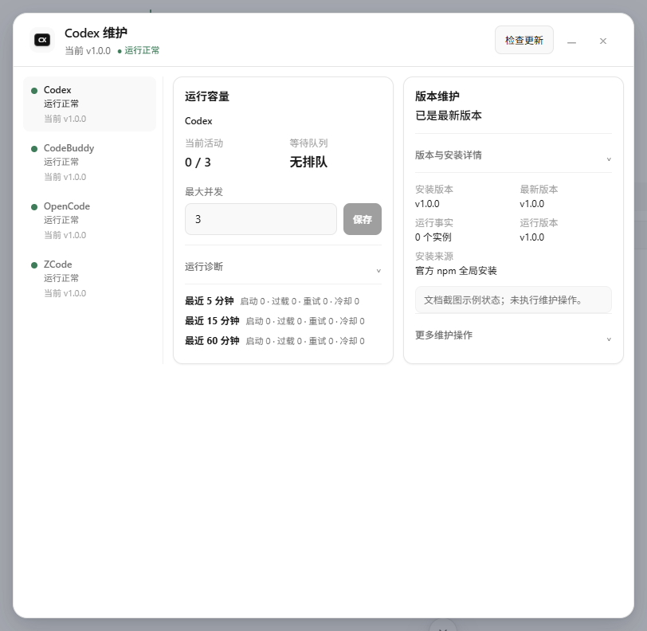

# Relay 安装与运行指南

本文介绍 Relay 的安装、配置、日常维护和故障排查。项目概览与核心能力见 [README](README.md)。

首次使用可依次阅读“前置条件”“获取源码”“首次初始化”和“启动、停止与重启”。业务工作台、RSSHub 和开发验收工具均按需配置。

常用入口：[网络配置](#网络配置) · [服务维护](#停止重启与页面维护) · [账号管理](#访问与账号管理) · [任务工作台](#任务工作台) · [数据备份](#手动备份) · [故障排查](#日志与故障排查) · [安全说明](#安全说明) · [开发验证](#开发验证命令)

## 前置条件

- Git：用于获取和更新源码。
- Node.js 24 或更高版本，内置 SQLite 不低于 3.51.3。目前已验证 Node.js 24.18.0，初始化时会检查版本要求。

不必安装全部四个引擎，但发送消息前至少需要安装并配置好一个。暂时没有可用引擎时，Relay 仍可初始化和启动，也可浏览历史、查看分享和创建草稿会话。

### 安装 Node.js

Relay 的初始化器、后端和前端都依赖 Node.js。请从 [Node.js 官网](https://nodejs.org/) 下载并安装 **24 或更高版本的 LTS 版本**，安装时保留将 Node.js 添加到 `PATH` 的默认选项。Node.js 安装包会同时安装 npm，无需单独安装。

安装完成后重新打开终端，并确认版本：

```shell
node --version
npm --version
```

`node --version` 应显示 `v24.x.x` 或更高版本。初始化器会检查内置 SQLite 版本；当前已验证 Node.js 24.18.0。如果终端提示找不到 `node` 或 `npm`，请先重新打开终端；仍无法识别时，检查 Node.js 安装目录是否已加入系统 `PATH`。Windows 默认安装目录通常为 `C:\Program Files\nodejs\`。

### 安装并配置 Codex

Relay 通过 Codex CLI 的 `app-server` 连接 AI 模型。管理员可在引擎维护面板安装官方 npm 包，也可在终端自行安装；面板使用的包名由 Relay 固定，不能指定任意包。Relay 不代理登录，也不修改登录凭据或 Provider 配置。Codex 本机用量统计会只读访问本机登录文件，以核对用量所属账号。

使用 npm 安装或更新 Codex CLI：

```shell
npm install -g @openai/codex
```

安装完成后重新打开终端，并确认 Codex CLI 和 `app-server` 可用：

```shell
codex --version
codex app-server --help
```

能显示 `app-server` 帮助信息，说明该入口存在；是否能正常连接模型，还需完成登录或 Provider 配置，并通过 Relay 的引擎检测。

使用 OpenAI 官方账号时，运行 `codex`，首次运行会引导选择登录方式并完成认证：

```shell
codex
```

完成后可以检查当前登录状态：

```shell
codex login status
```

如果使用自定义 Provider，请按照 Codex 高级配置文档自行完成配置。维护面板安装完成但未登录时会显示“已安装，待登录”和可复制的 `codex` 命令；在终端完成登录后点击重新检测即可，无需重启 Relay。

相关官方文档：

- [Codex CLI 安装与使用](https://learn.chatgpt.com/docs/codex/cli)
- [Codex 身份认证](https://learn.chatgpt.com/docs/auth)
- [Codex 配置](https://learn.chatgpt.com/docs/configuration?surface=cli)
- [Codex 高级配置与 Provider](https://learn.chatgpt.com/docs/config-file/config-advanced)
- [Codex 最新版本](https://github.com/openai/codex/releases)

### 安装并配置 OpenCode / ZCode

- **OpenCode**：当前适配器识别 `opencode` CLI，通过 ACP stdio 接入；维护面板的安装与升级使用固定的 `opencode-ai` npm 包。也可自行安装 CLI，在终端完成 Provider 配置后到维护面板重新检测。登录、密钥与 Provider 配置由用户管理。
- **ZCode**：安装并配置 ZCode 桌面应用，Relay 使用其安装目录内 `resources/glm/zcode.cjs` 的 app-server stdio 入口；有自定义安装位置时可通过 `RELAY_ZCODE_EXECUTABLE` 指定入口。它不依赖独立 npm 全局 CLI。升级在 ZCode 的“帮助 → 检查更新”或托盘菜单中完成，Relay 面板提供重新检测和打开当前设备 ZCode 的入口。

这两个引擎均由后端按会话管理 stdio 子进程，不需要额外固定监听端口。CLI/桌面应用已安装不等于协议和 Provider 已可用，以引擎维护面板的检测结果为准。

### 安装并登录 CodeBuddy

Relay 需要官方 `codebuddy` CLI；桌面客户端、IDE 扩展、`buddycn` 命令或 `.codebuddy` 配置目录不能替代它。管理员可在维护面板安装 Relay 指定的官方 npm 包，登录需在终端自行完成，Relay 不读取或修改 CodeBuddy 凭据。

Relay 通过 `codebuddy --acp --acp-transport stdio --agent cli --permission-mode default` 为活动会话按需启动独立子进程。

安装后请重新打开终端并确认：

```shell
codebuddy --version
codebuddy --help
```

帮助信息需包含 `--acp`、`--acp-transport`、`--agent`、`--permission-mode` 和 `--no-session-persistence`。Relay 使用标准 CLI Agent、默认权限模式和 ACP stdio 连接，不依赖普通终端界面自动启动的临时 Web Gateway，也不启动 CodeBuddy daemon 或占用固定端口。

子进程由后端按会话管理，退出 Relay 时只清理自己启动的进程树。CodeBuddy 临时不可用时，仍可读取既有会话和公开分享，但不能正常发送新消息；Codex 会话不受影响。

面板会区分“未登录”和“待复验”：前者需要在终端登录，后者表示上次可用性检测结果已过期。对“待复验”的 CodeBuddy 重新检测，会运行一次隔离的轻量可用性检查；通过后即可重新选择该引擎，不会执行升级或修改配置、凭据。

CodeBuddy 升级若在官方 npm 安装和来源验证成功后遇到模型额度耗尽（HTTP 429），会保留新版 CLI，但将 CodeBuddy 会话标为暂不可用；额度恢复后在维护面板点击“重新检测”即可恢复可用性。其他 readiness 失败仍按升级事务回退。升级后若面板显示额度不足，反复点击升级不会恢复额度。

## 获取源码

从 Gitee 获取源码并进入项目目录：

```shell
git clone https://gitee.com/daiwoniu/relay.git
cd relay
```

也可使用 [GitHub 仓库](https://github.com/daiwoniu/relay)。下文的根目录命令均在 `relay` 目录执行；需要切换目录的开发命令会单独标注。

## 首次初始化

安装 Relay 依赖并检查运行环境：

```shell
npm run setup
```

初始化时会检查 Node.js、npm、项目文件和 Relay 自身依赖。首次安装或依赖变化时，只验证受影响一侧的接口契约、类型和构建；依赖与关键文件未变时复用上次结果。全量测试需单独运行，普通安装无需执行。

核心环境检查通过后，首次安装或依赖变化时还会检查 Codex / CodeBuddy。引擎缺失、未登录或可用性检查失败只产生警告，不阻止 Relay 初始化和启动；Node、npm、项目文件或 Relay 自身依赖不满足要求时才会终止。

确实需要安装依赖、且当前使用非国内 npm 源时，初始化器会询问：继续使用当前源、本次临时使用腾讯云镜像，或终止。它不会修改全局 npm 配置。安装时会使用选定的 registry 替代 lockfile 中记录的源地址，不执行无关的 audit/fund 网络请求。

初始化成功后会在 Git 忽略的 `.relay-setup/setup-state.json` 中保存前后端依赖指纹。重复运行 `npm run setup` 时，未发生变化的依赖会直接跳过；只有 `node_modules` 缺失、lockfile 变化、Node 主版本变化、关键命令缺失或显式使用 `--force` 时才重新安装。

Windows PowerShell 若因执行策略阻止 `npm.ps1` 而无法运行命令，可改用 `npm.cmd`，例如 `npm.cmd run setup`，无需为此修改全局执行策略。

```shell
# 只检查，不安装
npm run setup -- --check-only

# 强制重新安装前后端依赖
npm run setup -- --force

# 非交互环境显式选择镜像
npm run setup -- --registry=china
npm run setup -- --registry=current
```

## 启动、停止与重启

```shell
npm run start
```

`npm run start` 默认以正式模式（production）运行，在当前终端窗口中启动 Relay。启动器会先准备前端构建，再依次启动后端、前端网关，并在 Codex 可用时启动 app-server。停止时按相反顺序清理。

没有可用 Codex 时，不会启动 Codex 监听端口。CodeBuddy、OpenCode 和 ZCode 的子进程由后端按会话管理。管理员在维护面板安装 Codex 并通过检测后，启动器会自动启动 app-server，无需重启整个 Relay。

修改前端源码、需要即时刷新（Vite HMR）时，使用开发模式：

```shell
npm run dev
```

开发模式默认使用配置的前端监听地址。`npm run dev -- --lan` 可仅在本次启动时将监听 IP 改为 `0.0.0.0`。

启动成功后会按网卡名称列出全部可用局域网地址；电脑同时连接 VPN、Wi-Fi 或有线网络时可能出现多个地址，移动设备应选择与自身处于同一网段的地址。

查看服务运行状态：

```shell
npm run check
```

运行期间需保持启动终端打开。按 Ctrl+C 或正常结束启动器时，会停止本次启动的受管服务。Windows 下强制关闭终端可能无法完成清理；可根据需要运行 `npm run stop` 清理残留，或运行 `npm run restart` 清理并重新启动。

`npm run check` 只检查状态，不会启动或停止服务，并会显示各服务的状态和实际地址。

### Windows 下的 Codex 端口恢复

Windows 下 Codex 默认在空闲时保持运行，避免频繁结束进程、重新绑定端口。停止时先清理完整进程树，再检查监听状态；完整重启不会仅凭 TCP 连接失败就认定端口已释放。

若两次采样确认原监听 PID 已不存在，但端口仍异常残留，启动器会自动选择附近可绑定的本机端口，记录在 `.relay-dev/codex-runtime-endpoint.json`，并同步给后端及后续的 check/stop/restart 命令，不改写 `config/relay.conf`。无需为此重启 Windows；单引擎重启仍失败时，可使用完整 Relay 重启。

若原端口仍由存活的 `codex.exe` 占用，停止或重启操作可清理它；无法确认进程归属时只报告冲突，不结束其他程序。

## 网络配置

各服务的默认地址和配置项如下。浏览器和手机应访问前端端口，不要直接访问后端或 Codex 端口。

- Relay 后端：由 `BACKEND_LISTEN_HOST` 和 `BACKEND_LISTEN_PORT` 配置，默认 `0.0.0.0:9181`
- production 正式前端网关：由 `FRONTEND_LISTEN_HOST` 和 `FRONTEND_LISTEN_PORT` 配置，默认 `0.0.0.0:9081`
- development Vite：使用同一前端端点；显式 `--lan` 时仅把本次监听 IP 覆盖为 `0.0.0.0`
- Codex app-server：由 `CODEX_HOST` 和 `CODEX_PORT` 配置，默认 `127.0.0.1:9281`（Codex 可用时，最后启动）
- CodeBuddy / OpenCode / ZCode：Relay 按会话管理 stdio 子进程，无固定监听端口

默认配置文件是纳入 Git 的 `config/relay.conf`，只存放可公开的部署参数，不得写入密码、令牌或其他秘密。Codex app-server 只允许配置回环 IP，避免直接暴露到局域网或公网。当前配置示例：

```properties
CODEX_HOST=127.0.0.1
CODEX_PORT=9281
BACKEND_LISTEN_HOST=0.0.0.0
BACKEND_LISTEN_PORT=9181
FRONTEND_LISTEN_HOST=0.0.0.0
FRONTEND_LISTEN_PORT=9081
PUBLIC_ALLOWED_ADDRESSES=relay.example.test:443
```

三个服务端口必须互不重复，监听 IP 必须填写明确的 IPv4 或 IPv6 地址。前端或后端监听 `0.0.0.0` / `::` 时，启动器会自动使用回环地址完成内部探活和代理。

`PUBLIC_ALLOWED_ADDRESSES` 控制允许的公网入口：

- 留空：不允许公网访问。
- 填写具体地址：多个地址用英文逗号分隔，省略端口时按 HTTPS 443 处理。上面的 `relay.example.test:443` 只是示例，需替换为自己的入口。
- 填写 `0.0.0.0`：允许任意公网地址并关闭精确 Host 限制，不建议日常使用。

公网访问还需配置 HTTPS 入口，并先修改默认管理员密码。修改 `config/relay.conf` 后需重启 Relay 才能生效，详见[安全说明](#安全说明)。

## 停止、重启与页面维护

如果配置的服务端点已有服务运行，`npm run start` 会显示状态并退出，不会重复启动。根据需要选择以下命令，不必依次执行全部命令：

```shell
# 停止服务
npm run stop

# 以正式模式重启
npm run restart

# 以开发模式重启
npm run restart -- --dev

# 以开发模式重启，并临时允许局域网连接
npm run restart -- --dev --lan
```

`npm run stop` 根据配置的 Codex、后端和前端端点定位并停止服务，不区分运行模式。正式模式重启会先完成前端构建，成功后才停止现有服务；构建失败时现有页面继续运行。新网关健康检查失败会自动恢复上一个可用构建。

前端体积报告分别统计各页面静态依赖的 JS/CSS，gzip 数值仅为估算。全部 JS、单包和离线脚本超过参考线时告警，不直接阻断；各入口 JS+CSS 相对固定验收基线增长同时超过 64 KiB 与 5% 告警，同时超过 256 KiB 与 25% 才阻断，构建资源或基线缺失仍失败。普通构建不自动抬高基线；仅调整预算规则时复核已有产物，无需重新编译。缓存复用也会检查清单、资源完整性和体积，防止漏掉被误删的异步文件。可运行 `node client/scripts/check-build-budget.mjs` 单独查看现有 `client/dist` 的报告。

### 前端更新与整体重启

通过根启动器启动时，页面会显示当前正式/开发模式、活动 Build ID、前端构建是否需要更新，以及启动器控制版本。

- 正式模式：前端维护操作先构建，再安全切换到新版本。
- 开发模式：只重启 Vite，普通前端源码修改通常由 HMR 自动更新。
- 后端源码修改：需要重启后端。

维护面板“高级操作”中的“重启全部服务与启动器”会先在现有服务运行期间完成前端构建和体积检查。准备失败则取消重启、保留现有服务；准备成功才替换当前运行器并重启全部受管服务。新运行器使用本次已准备好的 Build ID，不会在切换时再次构建，也不会执行 setup。

重启输出仍在原终端窗口中，Ctrl+C 可统一停止服务；Windows 不会为受管子服务额外打开空白终端。终端宿主自身更新后，需在终端执行一次 `npm run restart` 以加载更新。

### 服务维护与操作限制

“服务维护”的日常区提供前端、后端重启；“高级操作”提供整体重启，依赖异常时还会显示环境修复。整体重启和环境修复要求管理员权限，且当前没有 Git 冲突、活动 AI 任务或其他维护操作。环境修复成功后不会自动重启服务；修复失败时，可在终端运行 `npm run setup` 查看完整输出。

连续操作同一服务或引擎需间隔 30 秒，跨目标操作需间隔 10 秒。整体重启优先在原终端中替换运行器；缺少终端宿主时，由独立辅助进程接替重启。

实际维护时，进度卡显示最近两行输出，按 stdout/stderr 到达顺序合并、去除 ANSI 控制字符并尽力脱敏。断联后保留最后收到的内容，页面会提示连接中断和恢复；完整信息以启动终端和 `logs/` 为准。检查更新、重新检测、刷新页面和重试连接不会显示空终端区。

页面操作日志使用 `[MM-DD HH:mm:ss]` 本机时间，不同操作之间空一行，同一操作内部保持连续。

### 引擎维护

从账号菜单打开多引擎维护面板，可查看 Codex、CodeBuddy、OpenCode 和 ZCode 的安装版本、可用状态及更新信息。所有登录用户均可查看，只有管理员可执行维护操作或保存最大并发设置。

| 引擎 | 维护能力与限制 |
| --- | --- |
| Codex | 安装、重启、升级并重启；有活动任务时不能升级 |
| CodeBuddy | 安装、重新检测、无活动实例时升级；升级后检查可用性，失败时尝试回退 |
| OpenCode | 使用固定 npm 包安装、无活动实例时升级及重新检测 |
| ZCode | 重新检测、打开当前设备的 ZCode；更新由桌面应用完成 |

CodeBuddy 回退也失败时，会继续阻止新会话并提示终端修复；官方 npm 安装及来源验证成功后遇到额度 429 的处理方式见[CodeBuddy 安装说明](#安装并登录-codebuddy)。

Windows 下从页面安装或升级 Codex 时，还会在安装来源复验后检查 sandbox，并对 Relay 根目录及已登记、仍存在的项目根目录执行只读验证。异常时尝试回退；回退复验仍失败则保持 Codex 停止并提示查看启动终端。Relay 不会自动修改目录所有者或 ACL。

有新版时，面板按浏览器本地时区显示官方发布时间，精确到分钟，并最多展示两条完整的官方发布要点。展示时会清理 Markdown、链接和 issue 编号，不截断长句；官方缺少清晰说明时会提示。

桌面端按引擎列表、运行容量和版本维护分区展示，手机端使用引擎选择器。容量区显示活动任务、等待队列、冷却和运行诊断；版本、安装详情及更多操作可按需展开。



上图更新于 2026 年 11 月 16 日，使用当前正式界面组件和示例数据生成。版本、容量及检测结果均为示例，未执行安装、升级、重启或并发设置操作。

分步执行 `node --import tsx src/index.ts`、`npx vite --host`，或使用 IDE、PM2、Docker、系统服务启动时，不存在 Relay 根启动器托管关系，页面不会尝试关闭自身，只显示刷新、重新检测和 `npm run restart` 兜底指引。

## 访问与账号管理

浏览器访问配置的前端端口，默认是 [http://localhost:9081](http://localhost:9081)。前端监听 `0.0.0.0` 或适用的局域网地址、手机与电脑处于同一局域网，且防火墙允许连接时，可访问 `http://<电脑局域网IP>:<FRONTEND_LISTEN_PORT>`。

需要直接进入指定 Relay 会话时，可在页面地址后附加 `?session=<Relay会话ID>`，例如 `http://localhost:9081/?session=11111111-1111-4111-8111-111111111111`。登录并加载导航数据后，页面会自动打开当前账号可访问的对应会话；参数无效、会话不存在或已删除时，会安全回退到浏览器上次保存的聊天位置。

首次安装使用默认管理员登录：

```text
用户名：admin
密码：admin
```

登录后请立即修改默认管理员密码。系统不支持自主注册、邀请或创建其他管理员；管理员可在“账号设置”中创建普通成员、停用/启用成员和重置成员密码。新成员首次使用临时密码登录后只能修改密码或退出，改密成功后需要重新登录。

普通成员只能看到和管理自己创建的项目、会话与分享；管理员可查看和管理全部账号资源。每个账号都有自己的 Relay 默认项目和可选个人默认项目。多个账号可以登记同一个物理目录，目录内文件彼此通用，但 Relay 中的项目、会话、消息和排序仍各自独立。项目与会话详情会显示创建人。引擎并发容量由全部账号共享且仅管理员可修改，排队在全局容量下按账号公平轮转、账号内保持 FIFO。

登录状态通过 HttpOnly Cookie 保持 30 天，主动退出、停用、本人改密或管理员重置密码会撤销相应会话。公网配置只限制访问地址，不会增强默认密码；临时使用公网隧道后应及时关闭。

## 文件预览与刷新

从会话中的文件入口打开预览。电脑端可在会话右侧切换文件标签，手机端使用适配窄屏的预览面板。路径栏保留完整路径，可横向查看、选择或复制；桌面端还可悬停查看完整路径。

### 阅读、源码与 Git 变更

- **Markdown**：默认显示排版后的阅读视图，可切换带行号的源码，支持文内标题锚点跳转。
- **HTML**：可切换页面效果与源码，普通 HTML 默认禁用脚本。
- **Git 变更**：有可用差异时显示切换入口，查看文件相对 HEAD 的变更；不表示文件一定已提交。
- **大体积或截断文本**：使用源码视图，不启用排版阅读。超过 3 MB 的 UTF-8 文本只预览开头，最多 100 行、读取上限 64 KB。

Markdown 中的相对文件链接通过现有文件预览入口打开，仍需通过文件访问权限检查。图片以“查看图片”入口呈现，不会自动内嵌加载外部图片；阅读视图不渲染原始 HTML。外部网页链接在新选项卡打开。

### 刷新与阅读位置

点击“刷新文件”会重新读取文件正文、元数据和 Git 差异，不需要关闭后再打开标签。临时文件授权会沿用，仍受服务端权限检查约束。

在预览标签和视图间切换时，会分别记录各文件、各视图的阅读位置。内容加载后尝试恢复位置；用户主动滚动或进行键盘操作时停止自动恢复。这里记录的是外层内容视口，不包括浏览器 PDF 阅读器或工作表内部的滚动位置，也不保证跨页面重载或跨设备恢复。关闭文件标签后会清理该标签的状态。

### 下载与失败提示

点击“下载文件”会请求完整原文件，成功接收后交给浏览器保存。下载过程中按钮暂时不可重复点击；文件不存在、无访问权限或网络失败时，会通过统一提示弹窗说明原因和处理建议。关闭提示即可继续查看文件，不会向查看区插入下载异常，也不会将错误响应保存为文件或替换预览正文。

关闭文件标签、重新打开或刷新该文件会取消尚未完成的下载请求。文件格式不支持预览时，仍可尝试下载原文件；下载与预览使用相同的访问权限，临时文件授权仍只对当前文件生效。

### 文件不存在或已被移动

文件被删除、移动，或重新构建时生成了不同哈希的文件名，原路径可能失效。请核对当前路径并重新选择文件；刷新不会自动将失效链接替换成另一个文件。

更新预览相关的前端或后端后，需加载新构建并重启相应服务，才能看到对应行为。具体操作见[前端更新与整体重启](#前端更新与整体重启)。

## 任务工作台

### 任务工作台业务仓库配置

工作台的业务仓库根目录由可选的本机 `config/workspace-console.local.conf` 指定。启动时文件不存在会自动生成带注释的配置，默认 `workspace_root=` 留空；已有文件不会覆盖。需要工作台业务功能时，填写当前电脑的绝对目录，也可参考 [示例配置](config/workspace-console.example.conf)：

```conf
# 本机业务仓库根目录
workspace_root=D:/projects/my-workspace
```

Linux/macOS 请填写对应系统的绝对目录。这里指定的是业务仓库，不是 Relay 源码目录；仓库内需具备以下内容：

| 相对业务仓库根目录的路径 | 用途 |
| --- | --- |
| `tasks/task-registry.json` | 本地任务台账 |
| `ai/skills/operate-feishu-project-openapi/` | 飞书集成技能 |
| `.runtime/conda-envs/py312/` | 对应的 Python 运行环境 |

配置使用 `key=value` 格式，按第一个 `=` 分隔，忽略空行和以 `#` 开头的注释行。路径不加引号，可包含空格、`=` 和 `#`。配置文件不进入 Git，换电脑后需按本机路径重新填写。

配置文件缺失、为空或 `workspace_root` 留空时，Relay 可正常启动和聊天，使用相关工作台功能时才会提示配置。格式错误、根目录不存在或必要文件缺失也只影响对应功能，不会回退到其他电脑的目录。

修改配置后需重启后端，已有会话与台账仍须属于新配置的业务仓库。

具体任务只从台账和报表读取，不在产品源码或配置中设置任务 ID 与链接例外。子任务链接依据报表提供的父项链接、子任务 ID 及节点信息生成，缺少可靠数据时不猜测。

### 任务工作台任务归类

中央台账可用 `feishu_primary_work_item_id` 指定 `feishu_work_item_ids` 清单内的主工作项。工作台仅用它标识、优先展示可靠链接及在新会话草稿中定位，不改变其他关联或任务分组；未登记时不猜主项。打开 README 的入口称为“预览任务说明”，中央台账摘要与任务说明分别展示。

工作台按本人当前这轮的工作归类，父项整体流程作为背景显示：

- **处理中**：本地明确执行中，或已有有效开始时间、精确关联的带时间执行记录、有效且大于零的实测执行用时，并且本轮尚未收口。已开始但等待、阻塞、暂停或待复核的工作保留在处理中，并显示具体状态；仅有飞书当前节点、未完成子任务、会话更新时间或台账核验时间，不足以证明已经开始。
- **待处理／待确认**：当前已轮到本人但尚未开始，或开始证据不足的等待、暂停及状态待核对事项；卡片保留具体原因。不同子任务和本地台账独立判断，等待中的台账不会遮住其他待处理任务。
- **已完成／已结束**：本轮个人工作已完成，或任务已结束、关闭、取消。父项仍流转时显示“本轮已完成”，保留当前流程和未来参与节点；未来节点激活后重新进入待处理。
- **我参与的流转中事项**：统一跟踪个人工作已完成或后续负责、整体流程仍未结束的事项；未来责任不单独列区，也不提前计入当前待办或完成数。此跟踪视图可与已完成列表交叉展示，不重复计数。

已结束需求与新建关联缺陷分别归类，不因缺陷未结束而重新打开原需求。飞书当前个人责任与本地完成记录存在差异时提示核对，不自动修改任何来源的状态；本地等待与飞书当前责任并存时同时展示等待条件和责任节点。近期焦点优先执行中、待核对及可处理工作，外部等待靠后，只有暂停工作的事项不占焦点。

缺陷个人完成提示区分报表中的子任务结果、台账登记和状态/角色推断；报表缺少责任信息时提示刷新核对，完成记录与验收或负责人角色并存时提示核对本轮范围。这些提示不改变原分栏或自动更新台账，推断及台账登记不代表整体流程已结束，也不替代业务责任的实时核验。

任务的推进提示依据开始时间、核验时间和明确关联的执行记录，不使用飞书父项或会话的更新时间。当天有记录时显示“今天有推进记录”；满 7 天无记录时提示“待跟进”，并降低等待事项的焦点优先级，但不改变任务阶段，也不重开已完成、关闭或取消的任务。

实测执行用时只能补充“已经开始”的依据，不能用于推算开始日期或推进时间。没有有效日期时显示“推进时间未登记”；缺少开始依据的等待任务仍保留在“待处理／待确认”，不会仅因更新时间较新或有关联会话而归入“处理中”。

已完成的个人流转事项统一保留在已完成列表；查看详情不直接重开任务。需要重新处理时在具体台账或任务详情中操作。本地记为等待但正文说明本轮已完成的记录，保留台账原始状态，整体阶段按开始证据判定；仍需人工核对后调整，界面不根据正文猜测完成状态。

“已完成／已结束”列表默认展示 10 项。滚动到当前内容末尾，可点击“加载下一页”再显示 10 项；不会触底自动加载，按钮也不会固定在页面底部。每页标明页码和条目范围，末尾显示已展示数量与总数，全部展示后隐藏加载按钮。

搜索、任务关联筛选或已完成状态筛选变化时，列表回到前 10 项；分类与统计仍按全部结果计算。“我参与的流转中事项”使用左右两列卡片：左侧显示标题、节点和更新时间，右侧提供飞书跳转与“处理”入口。

流转区的“处理”按整体流程跟踪，可继续已关联会话，不会仅因个人本轮已完成就强制重开会话。任务详情中的台账与主卡片共用进度证据；分组主操作指向当前可处理的具体任务或缺陷，已有本地处理台账的独立缺陷不重复展示待办卡片。独立飞书事项与其唯一明确关联的已完成台账同在完成栏时，只展示事项卡片，台账保留在详情中，也可按台账名称或编号搜索；仍未完成、关联多个事项或仅从目录编号推测关联的台账继续单独展示。独立事项详情与卡片共用个人完成判定，刷新保持事项视图及全部关联台账，不自动跳入第一条台账；本轮已完成的事项可从具体台账选择重新处理。

页面主线为当前焦点、任务列表、我参与的流转中事项；等待／阻塞原因在对应任务及状态筛选中查看。底部“执行记录与会话”默认折叠，集中提供最近执行记录、最近会话及未关联任务标识，两类数据仍可分别刷新；具体任务的执行记录仍在任务详情中查看。

### 任务工作台数据刷新

页面先展示上次成功获取的数据，再按各来源的缓存有效期刷新。缓存过期表示需要获取新数据；请求超时则会提示失败并安排重试，不会清空已确认归属的旧数据。

顶部时间区分别展示台账和飞书的“数据时间”（源台账或报表生成时间）与“最后刷新”（最近一次成功获取该来源数据的时间）。读取已有缓存不会推进最后刷新时间；刷新失败保留上次成功时间，并另外显示最近失败尝试。桌面端两来源并排，窄屏上下排列。

| 来源 | 缓存有效期 | 页面可见时的自动行为 | 手动刷新范围 |
|---|---|---|---|
| 本地台账、Run、用时 | 1 小时 | 每 30 秒及切回页面时检查到期 | 顶部“刷新任务”选择“刷新本地”或“全部刷新”，或本地失败提示的“重试”重新读取本地数据 |
| 当前 Relay 会话与任务关联 | 每次工作台请求读取 | 随页面打开和本地刷新更新 | “最近会话”仅复用台账快照并重新读取会话；不会扫描 Run 或请求飞书 |
| 飞书报表 | 3 小时 | 每 30 秒及切回页面时检查到期 | 顶部“刷新任务”选择“刷新飞书”或“全部刷新”，或飞书失败提示的“重试”拉取完整报表 |
| Codex 官方额度与本机用量 | 30 分钟 | 工作台卡片检查到期，侧栏订阅同一份账号结果，避免两个定时器重复拉取 | Codex 卡片一次请求共用一次账号核实；本机数据失败时保留同账号最近一次成功的用量结果 |
| 飞书操作记录 | 10 分钟 | 仅当前详情打开时检查到期 | 可单独刷新；顶部选择“刷新飞书”或“全部刷新”也刷新当前打开详情的操作记录 |

页面不可见时不发起定时刷新。首次读取失败、请求超时或服务端返回失败快照时，自动重试按 5、10、20、40、60 分钟退避，上限 60 分钟；成功恢复后重置。主动关闭页面或取消请求不计入失败。失败提示的“重试”仅重试对应来源；顶部“刷新任务”下拉可选择全部刷新、刷新本地或刷新飞书，选择后立即执行，均不连带刷新 Codex。

点击强制刷新时，即使已有普通缓存读取正在进行，也会保证重新获取一次对应来源的数据；必要时等待普通读取结束后执行，并合并重复的强制刷新请求。刷新不会改变任务关联或完成状态的判定规则。

本地任务详情只刷新本地数据，保留现有飞书快照；飞书详情刷新仍依赖完整飞书报表接口，但不会连带强制扫描 Run。运行记录等本地卡片刷新后同步更新本地任务列表。Codex 官方结果和本机用量必须对应本次已核实的同一账号，账号未核实或发生切换时不展示其他账号的本机用量。侧栏识别到账号变化时，资源卡立即补读新账号用量；已有资源读取时等待其结束，避免重复请求。

## 工具集

### 访问与记录同步

无需登录即可访问 `/tools`，也可从登录页或空会话页进入。AI 情报在新选项卡打开，日历和天气使用弹窗，随机问候语等其余工具在卡片下方展开。支持搜索、置顶和常用排序。

游客的使用记录保存在当前浏览器；登录后改用服务端账号记录，同一账号可跨设备共享。游客记录不会自动并入账号。页面打开、切回前台及保持可见时，每 30 秒同步最新配置；多设备使用次数会累加，置顶按单项更新。同步失败时会在页内提示，并提供重试入口。

### 布局与使用方式

日历和天气弹窗跟随工具页主题。位置以整张卡片为锚：左侧卡片优先向右，右侧优先向左，中间优先下方；弹窗超过屏幕一半宽或侧边空间不足时改到下方。高度不足时按可用空间收缩并内部滚动，下方空间过小时优先使用上方；卡片本身占满屏幕、上下均无可用空间时才限制在屏幕内覆盖显示。

工具集的展开面板紧接所点卡片所在行，手机单列时紧接当前卡片；展开时不自动滚动或移动焦点，展开或弹窗期间对应卡片保持高亮。卡片按可用列宽排列，数量不足一行时保留空列，不拉伸单张卡片。天气默认按网络 IP 识别当前地区，可输入城市切换，或点击“当前地区”恢复自动识别。全部工具按固定顺序展示，常用工具按本次页面加载时的使用记录排序，使用次数继续保存，刷新后才更新排序。顶部品牌为静态标识，显示当前主题图标；宽屏按钮仅桌面宽度显示，可切换自适应多列布局，宽度偏好保存在当前浏览器。浏览器标题为“工具集 · Relay”。

### 本地计算工具

| 工具 | 使用说明与限制 |
| --- | --- |
| 时间转换 | 明确区分秒、毫秒和带时区的 ISO 日期 |
| JSON 格式化 | 保留原始数字，避免长 ID 被浮点转换改写 |
| 二维码 | 使用本地 uqr 依赖生成，可下载 PNG / SVG |
| 文本对比 | 按行对比，每侧最多 500 行 |
| 单位换算 | 支持重量、长度、面积、容量和温度 |
| 日期助手 | 按自然日计算日期间隔、前后日期和周岁；闰日生日在非闰年按 3 月 1 日满周岁 |
| 购物计算 | 支持同单位单价比较、折后减券和单次满减；金额按分计算并四舍五入 |
| 随机选择 | 去除空行与重复候选，支持不重复抽签和尽量均匀分组 |
| 番茄钟 | 进度按当前设备和身份保存在浏览器；刷新或重新打开后可继续计时，关闭页面不会发送提醒 |

上述本地计算工具的输入不会发送到服务端。番茄钟在后台按结束时间校准计时；日历、天气等联网工具不属于本地计算范围。

工具集随常规初始化和启动流程提供，依赖更新使用 `npm run setup`，数据库结构由后端统一启动入口检查与迁移，不需要额外执行工具集专属迁移或首次部署停服步骤。公开接口仅提供日历天气读取；账号工具记录仍需登录且仅能操作本人。

## AI 情报

无需登录即可访问 `/news` 阅读默认资讯流，也可从工具集的“AI 情报”在新选项卡打开。登录后可切换“全部 / 我的关注”，并在卡片或“我的设置”中添加关注、屏蔽规则；访客不能保存这些规则。

管理员从“管理来源”进入 `/admin/news`，可管理 RSS/Atom、GitHub Releases 和 Hacker News 来源，查看抓取状态、验证并启用来源、设置全站屏蔽规则，以及隐藏或修正单条资讯。

普通用户点击刷新时只读取 Relay 已保存的资讯，不会直接触发上游抓取。页面可见时约每 2～3 分钟检查一次是否有更新，有新内容时由用户点击载入。

### RSSHub 社交平台订阅

社交平台自动采集需要单独部署 RSSHub，不属于 Relay 的初始化或启动流程。与 Relay 后端部署在同一台机器时，可将 RSSHub 绑定到 `127.0.0.1:1200`，管理页直接使用默认地址 `http://127.0.0.1:1200`；也可填写公开 HTTPS 根地址。

每个订阅对应一个账号、关键词或热搜路由。保存前会验证 RSS 输出，通过后由 Relay 定时采集并过滤 AI 相关内容。

| 快捷订阅 | 额外条件 |
| --- | --- |
| 微博账号、关键词与热搜 | 使用对应平台的账号或路由标识 |
| 抖音账号、小红书账号笔记 | RSSHub 部署需支持浏览器，仍可能受反爬或内容更新延迟影响 |
| 微信公众号的新榜路由 | 使用新榜对应标识，并在 RSSHub 配置 `NEWRANK_COOKIE` |

快手及其他热榜尚无经本项目验证的快捷路由，可在“新增来源”中添加可解析的公开 HTTPS RSS 地址。RSSHub 的登录信息由部署者维护，不写入 Relay 的资讯来源配置。

RSSHub 官方提供 `diygod/rsshub:chromium-bundled` 镜像供需要浏览器的路由使用。已有 Docker 的主机可用项目内的可选配置执行 `docker compose -f config/rsshub.compose.yml up -d`，端口只绑定本机；更多配置见 [RSSHub 部署文档](https://docs.rsshub.app/deploy/)。RSSHub 实例、浏览器依赖和平台凭据由部署者维护；此服务不属于 Relay 的 `setup/start` 流程。若 RSSHub 尚未运行，来源验证会失败，现有资讯源继续运行。

### 阅读与翻译

资讯页顶部可切换国内、海外或国内外。浏览器支持 Translator API 英译中时，英文卡片会显示“翻成中文”；点击后在本机翻译，首次使用可能需要下载语言模型。可随时切回原文，不支持翻译的浏览器直接显示原文。

默认窗口为最近 48 小时，每页 20 条；可以自选历史日期，但单次最多查询 31 天、50 条。资讯不因超出默认时间窗口而自动删除。来源失败时保留既有内容和真实的最近成功时间；磁盘空间不足时暂停新增采集，仍可阅读已有资讯。

## 数据存储与恢复

默认主数据库为 `server/data/relay.db`。资讯保存在主库同目录的 `news/` 子目录：`news.db` 保存来源、规则、偏好和抓取状态，`news-YYYY-MM.db` 按月保存资讯。若设置 `RELAY_DB_PATH`，则以该文件所在目录为准。

### 手动备份

1. 完整停止后端，避免备份期间继续写入。
2. 复制主库和整个 `news/` 目录；若仍有 `-wal` / `-shm` 文件，须一并保留，不可只复制活跃的 `.db` 文件。

恢复时保持原目录结构。资讯的账号 ID 映射以主库为准，应使用相互匹配的备份。

上述步骤只备份数据库。项目文件、Relay 托管附件和自定义主题等文件也应另行备份，不能仅靠 `.db` 恢复。

### 启动检查与迁移

后端在接受请求前检查数据库版本。首次安装直接创建 SQLite 数据库；已有数据库需要升级时，会先在同目录生成不可覆盖的 `.pre-native-v1-<编号>.bak` 备份，再通过事务迁移并校验业务数据。新闻库按同样方式逐库处理，附件和主题文件位置不变。

全部检查通过后才开放服务，后续启动不会重复迁移。数据库损坏、版本不受支持或缺少必需字段时会拒绝启动，不会覆盖已有数据。

`setup` 只准备环境，`check` 只检查运行状态。数据库迁移由后端在启动时执行，必须确保此前运行的后端已退出，无需手工执行 SQL 或单独的迁移命令。

升级后已有新写入时，不自动降级到迁移前备份。遇到问题先停写并保存当前数据，再核对恢复；迁移备份不会自动删除。

主库缺失但同目录仍有新闻库、主题文件或数据库备份等已有安装证据时，启动会明确报错并要求恢复，不创建替代空库。已建立的新闻元库或登记有数据的月库缺失时同样拒绝启动。首次创建失败时，只清理本次创建且仍为空的数据库文件以便重试；未知空库和非空库都保留，不自动覆盖。

启动器为后端初始化、备份与迁移预留最多 10 分钟；正常启动通过健康检查即可继续，进程提前退出会立即报告失败。其他服务仍采用 30 秒启动等待。

## 项目与默认工作区

首次启动会自动创建 Git 忽略的 `workspace/` 目录，并登记为“Relay 默认项目”。默认项目可以重命名，但不能删除。如需清理工作区中的文件，请直接管理 `workspace/` 目录内容。

首次登记或从回收站恢复项目时，Relay 会补齐项目根目录中缺失的 `AGENTS.md`、`WORKBUDDY.md` 和 `README.md`，不会覆盖已有同名文件。

- 两个规则文件都缺失：创建完整默认规则，包含中文回复、平衡模式、安全确认、验证和交付要求。
- 任意规则文件已存在：保留原有规则体系，不注入默认语言要求。
- 已有 `AGENTS.md`，但缺少 `WORKBUDDY.md`：新增的 `WORKBUDDY.md` 仅引导 AI 阅读原有规则。
- 新建 `README.md`：说明哪些基础文件原已存在、哪些由 Relay 新增，以及它们的入口关系。

已登记且未删除的项目再次选择时不会重新初始化。默认项目则会在每次后端启动时补回被删除的基础文件。

## 日志与故障排查

### 操作失败时先核对状态

错误提示会分别说明问题、处理建议和异常详情。发送准备阶段失败时，会说明本轮尚未发送，并区分引擎、超时、模型、附件、存储、权限和状态冲突等原因。

网络中断或超时不一定代表操作失败。发送、取消结果不明确时，应先核对实际状态，避免重复提交。本机准备异常的详情会清理凭据、绝对路径和终端控制字符。

### 终端与文件日志

终端输出的非空行带 `[MM-DD HH:mm:ss]` 本机时间，显示启动前检查、紧凑进度、浏览器入口、访问状态和 `logs/` 日志入口。子服务常规输出及维护操作详情写入 Git 忽略的 `logs/`，不实时刷到终端；启动失败时会在终端回放最近的服务日志。production 构建成功时只显示构建结果，构建失败时显示错误详情。npm 自身在脚本开始前打印的命令横幅不属于 Relay 输出。

| 文件 | 内容与保留范围 |
| --- | --- |
| `logs/relay-YYYY-MM-DD-NNN.log` | 近期组合运行日志，包含毫秒时间、服务来源和输出通道；保留 15 天，总量不超过 500 MB |
| `logs/events-YYYY-MM.log` | 启动、停止、重启、异常退出和日志降级等关键事件；保留 90 天，总量不超过 20 MB |

同一天重启时优先续写最后一个未满的运行日志文件，并标记新的启动边界；跨天或下一行会使文件超过 10 MB 时，创建新分段。异常超大的单条事件会按 UTF-8 安全截断并标记。日志创建、轮转或写入失败不会阻止 Relay 运行，启动器仍保留最近 64 KiB 的内存输出供失败时回放。

### 自动运行诊断

启动器每 10 秒向组合日志写入一次 `runtime-diagnostics` 记录，包含前后端和受管 Codex 的健康响应耗时、CPU、可用内存、后端进程内存和事件循环延迟。正常空闲停止的 Codex 不会被探测或唤醒。

- 服务不可达、响应超过 1 秒、采样明显迟到或 Codex 连接异常时，记录最近最多 6 次采样。
- Windows 还会只读采集磁盘队列、换页读取和监听端口 PID；最多每分钟一次，同时最多一次，每次最多 5 秒。冷却期间仍记录具体故障码，采集失败不会触发重启。
- 健康探测最多等待 2 秒，不会重叠执行。后端指标的 `ageMs` 表示数据新鲜度；后端 `cpuPct` 以占满一个逻辑核心为 100%，外层 `cpuPct` 表示整机占用。
- 诊断只记录固定数值与状态，不采集聊天正文、请求内容或进程命令行，并受日志容量和保留期限约束。

更新启动器后需完整重启，才能加载新的诊断逻辑；单独运行后端时只输出后端指标。

### 存储与连接恢复

数据库通过 SQLite/WAL Worker 提交增量事务。排查保存和运行问题时，应结合健康响应、事件循环、运行诊断及受控 `NATIVE_*` 错误码；关键写入结果不明确时，按操作回执和最新状态核对，避免重复提交。

运行事件队列失败时，`NATIVE_RUNTIME_UNCONFIRMED` 会记录脱敏的会话、回合和连接关联号，以及失败阶段、受控错误码、待处理事件数量与字节数，不记录原始异常文本或业务正文。

向前端发送结果不会阻塞事件保存或完成后的任务调度。发送超时或积压过大时，会以 1013 关闭该客户端连接，由页面自动重连并同步快照。已保存消息仍按当前访问权限投递，不因下一轮开始而失效。

失败回合收到结束或连接关闭信号后，仅对支持恢复的引擎重新核对原回合快照，每回合最多自动尝试一次，不重发输入。恢复期间阻止新的控制请求；关闭服务时会等待已开始的恢复工作结束。未确认恢复成功时，保留活动状态及对应运行租约。未恢复的故障可在所有活动任务安全结束后，通过重启后端进入启动恢复流程。

### 性能分析与日志隐私

需要评估 Codex / CodeBuddy 的连接、初始化、会话恢复和首个输出耗时时，可运行 `npm run performance:engines`。该命令只读扫描本地组合日志，按引擎汇总全部样本量、整体成功率和标签计数；阶段 p50/p95/max 只使用“成功、既有会话、冷连接、非恢复”的决策样本，避免新会话、连接复用、失败和重启恢复污染冷启动判断。命令不会发起真实引擎请求，也不会输出会话标识或业务内容。

文件日志会移除 ANSI 控制字符，并尽力隐藏 Authorization、Cookie、密码、token、secret 和 API key 等常见敏感字段；自定义秘密和普通业务内容无法保证全部识别。日志可能包含工作路径、thread ID、命令和会话相关输出，不要直接公开分享完整日志文件。`logs/` 必须是项目根目录下的真实目录，启动器不会跟随符号链接或目录联接向项目外写入。

## 安全说明

- Relay 首次启动会自动生成 256 位访问令牌，保存在 Git 忽略的 `server/data/access-token`。
- 浏览器始终访问配置的前端端口；production 正式网关和 development Vite 代理都会为 `/api` 与 `/ws` 自动注入令牌。
- REST API 与 WebSocket 同时校验内部 Relay 令牌和用户登录会话；直接访问配置的后端端口时，业务接口默认返回 401，`/api/health` 保持公开用于健康检查。
- 资讯的两个 `/api/public/news` GET 接口只免登录，仍必须经过前端网关注入内部 Relay 令牌；管理员和个人规则接口继续要求登录与服务端角色检查。
- 用户密码使用带随机盐的 scrypt 哈希保存，登录会话只保存随机令牌的 SHA-256 哈希；浏览器 Cookie 设置 HttpOnly 和 SameSite=Lax。
- REST/WebSocket 默认只允许本机、回环和私网来源。
- 配置的公网来源只接受精确 HTTPS Origin 和精确 Host+端口；正式网关与 Vite 都会覆盖外部传入的转发头，后端仅据可信 HTTPS 转发设置 Secure Cookie。
- `PUBLIC_ALLOWED_ADDRESSES` 是来源边界而不是登录凭据；`0.0.0.0` 会放宽 Host 限制，不应作为日常配置。
- 文件读取默认限制在 Relay 已登记的项目目录内；项目外文件仅能通过用户明确触发的单文件、单次授权访问。
- 公开分享使用 256 位随机令牌和不可变快照，失效响应不返回消息内容；访客页面不连接 WebSocket，也不访问本地文件接口。
- 管理员对他人账号、项目、会话与分享产生影响的写操作只记录固定审计元数据，不记录消息正文、命令、文件路径、密码、令牌或 Cookie。

## 页面验收与截图

### 页面验收

Relay 提供可选的 Microsoft Edge 无窗口页面验收工具，不会随初始化、测试、构建或启动自动运行。需要时，在交互式终端建立本机加密认证，再显式执行验收：

```shell
npm run acceptance:auth
npm run acceptance:page
```

默认验收只读，不创建会话、发送消息、停止任务或重启 Relay。真实引擎场景需要显式指定允许执行的引擎与场景，完整参数见 `npm run help -- acceptance:page`。移动视口只反映浏览器模拟结果，真机触摸、系统键盘和网络切换仍需在实际设备上验证。

### 文档截图

使用 `npm run screenshots:readme` 更新固定场景的界面截图。首次使用前运行 `npm run acceptance:auth` 配置本机验收认证；配置位于 `config/acceptance/`，本机认证文件被 Git 忽略。工具不会自动启动或重启 Relay，也不创建业务数据或调用真实引擎。部分场景使用正式组件和示例数据生成，交付时需保留相应说明。

截图产物位于 `.relay-dev/acceptance/`。检查账号、项目、路径及业务内容后，将选中图放入 `assets/readme/`；不要提交未脱敏截图、认证信息和中间产物。

## 开发验证命令

普通安装和使用无需执行这些命令；修改 Relay 源码后按改动范围选择验证。

查看根目录命令说明：

```shell
npm run help
```

各命令支持追加 `help` 查看中文帮助，例如 `npm run setup help`、`npm run restart help` 或 `npm run performance:engines help`。

`test:scripts` 用于初始化器、启动器、帮助脚本及相关公共模块的回归验证。下面列出可用验证命令，并非每次修改都需要全部执行。

```shell
npm run test:scripts
npm run setup -- --check-only
npm run check

cd server
npm test
npm run typecheck
npm run build
npm run verify:security
npm run verify:auth
npm run verify:continuity
npm run verify:multidevice
npm run verify:title

cd ../client
npm test
npm run typecheck
npm run build
```
