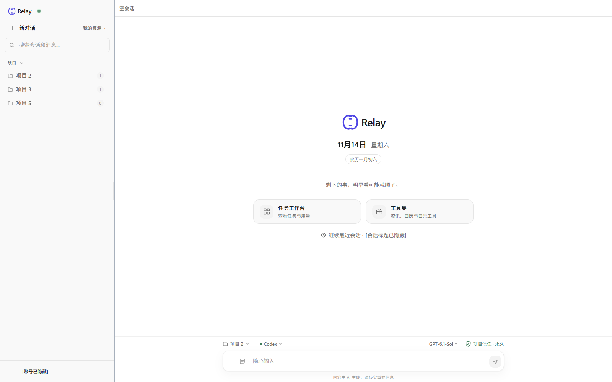
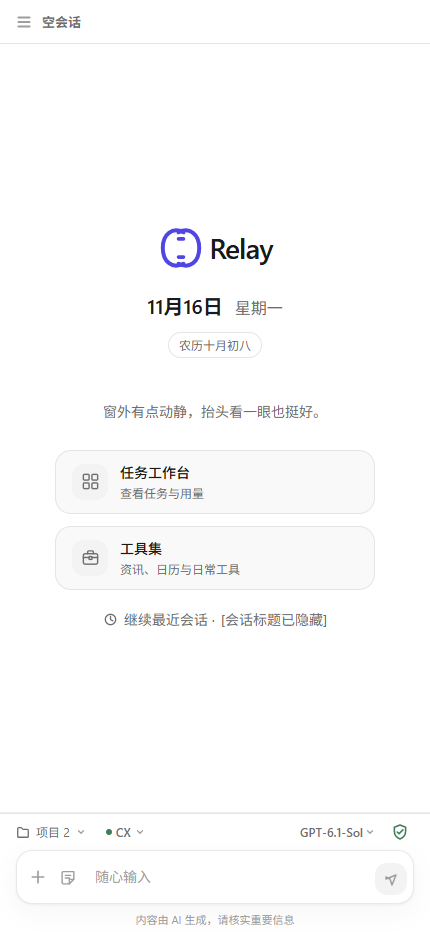
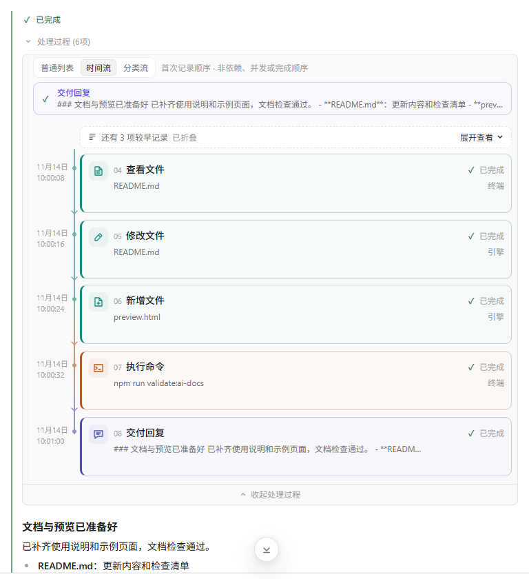
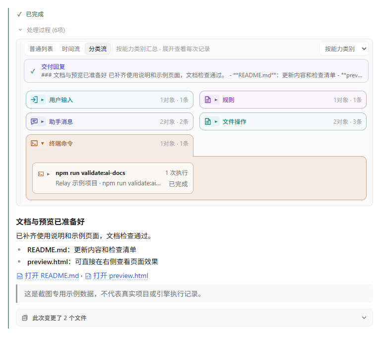
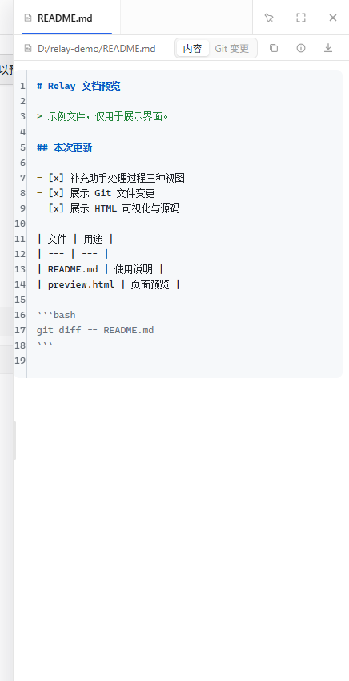
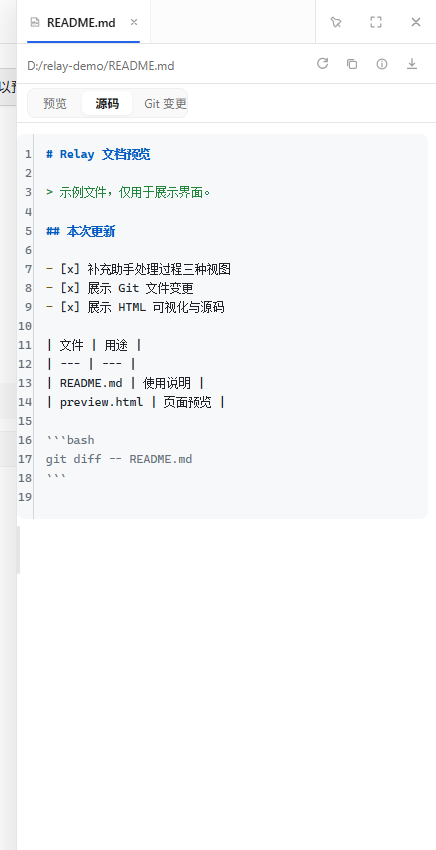
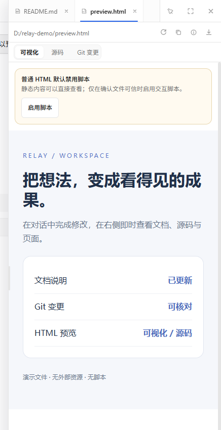
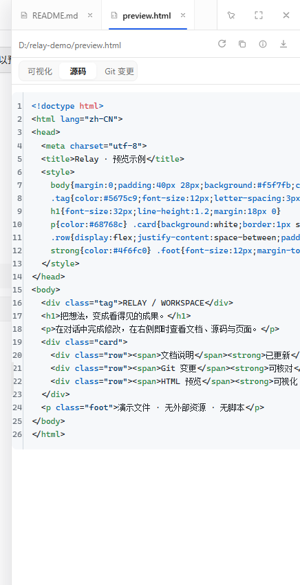

# Relay

Relay 是一个在本地运行的多引擎 AI 工作台，统一接入 Codex、CodeBuddy、OpenCode 与 ZCode。你可以按项目管理会话，在电脑和手机上查看同一任务的进度与历史记录。

## 适用场景

- **集中使用多个 AI 引擎**：为不同会话选择引擎和模型，在同一界面查看任务进度、处理授权请求。
- **在电脑与手机之间切换**：电脑上发起任务，手机上查看进展、补充消息。离开页面后，任务仍由运行 Relay 的设备继续执行。
- **了解 AI 的执行过程**：查看任务计划、命令、工具调用和执行结果，同时预览文件内容与 Git 差异。

Relay 服务运行在你自己的设备上，会话数据也保存在该设备上。使用模型时，请求及相关项目内容仍由所选引擎和模型服务提供方（Provider）按各自规则处理。引擎登录和 Provider 配置需自行完成，Relay 不代理登录，也不修改引擎凭据或 Provider 配置。Codex 本机用量统计会只读访问本机登录文件，以核对用量所属账号。

<table>
  <tr>
    <td width="72%" valign="top"></td>
    <td width="28%" valign="top"></td>
  </tr>
  <tr>
    <td align="center">桌面首页</td>
    <td align="center">移动首页（移动视口截图）</td>
  </tr>
</table>

首页截图更新于 2026 年 11 月 16 日，取自本机运行的正式页面。账号、项目名、会话标题、位置与个人用量已脱敏，界面未经重绘。移动版截图通过浏览器模拟手机屏幕尺寸，仅展示响应式布局，不代表真机触摸测试结果。

## 快速开始

先安装 Git 和 Node.js 24 或更高版本。Node 内置的 SQLite 版本须不低于 3.51.3；目前已验证 Node.js 24.18.0，初始化时会检查版本要求。

获取源码并启动：

```shell
git clone https://gitee.com/daiwoniu/relay.git
cd relay
npm run setup
npm run start
```

也可以从 [GitHub](https://github.com/daiwoniu/relay) 获取源码。启动成功后访问 [http://localhost:9081](http://localhost:9081)。

不必安装全部四个引擎，但发送消息前至少需要配置好一个。暂时没有可用引擎时，仍可浏览历史、查看分享和创建草稿。引擎的安装、登录和 Provider 配置见[安装与运行指南](INSTALL.md#前置条件)。

手机与电脑处于同一局域网时，可访问 `http://电脑的局域网IP:9081`。如果修改过前端端口，请使用实际端口，并确保监听地址与防火墙允许连接。通过公网访问则需额外配置，请先阅读[安全说明](INSTALL.md#安全说明)。完整的安装、网络配置和维护步骤见 [INSTALL.md](INSTALL.md)。

通过 SakuraFrp 等反代获取访问者 IP 时，可在配置中显式设置 `TRUSTED_PROXY_IPS`；只有代理 IP 和精确公网入口同时匹配，才采用代理追加的来源。配置条件及回退行为见 [网络配置](INSTALL.md#网络配置)。

## 核心能力

### 会话管理与多端同步

- **选择引擎与模型**：为会话选择引擎和模型，也可在设置中心保存新会话的默认模型、推理强度和速度。两处使用相同的推理强度滑杆和速度按钮，调整后点击应用。可选项取决于引擎和模型支持情况；Codex 按模型可用档位提供标准、快速或极速。默认设置不改变已有会话，切换默认引擎会清空模型偏好。会话交接功能可帮助你换会话继续工作。
- **按项目管理会话**：以本地工作目录组织项目，支持会话搜索、改名、归档和草稿。删除的会话可从回收站批量恢复。
- **同步进度与已读状态**：同一账号可在电脑和手机上查看会话、任务及已读状态。浏览器断开后，任务仍会继续执行，但运行任务的设备、Relay 服务和相关引擎需保持运行。
- **补充消息与排队**：任务执行期间也可发送消息。Codex 会优先将消息补充到当前回合，无法补充时排队等待下一轮；其他引擎使用排队方式。可预览待发送内容、取消尚可撤回的消息。发送结果不明确时会提示核对，避免重复提交。
- **处理授权与提问**：集中提醒各会话中待处理的授权请求和问题，可跳转到对应会话回答。Codex 的异步问题在助手回复结束后仍可回答。

回收站的永久删除功能仅对管理员开放，并受运行状态和未决消息等保护条件约束。清理仅涉及 Relay 数据及托管附件，不会删除项目源文件或 Codex 原始会话记录（JSONL）。

### 查看 AI 执行过程

Codex 的处理过程支持普通列表、时间流和分类流三种视图。时间流按执行顺序展示进展；分类流按能力、执行通道或项目汇总工具调用，展开后可查看每次调用的输入、结果和状态。其他引擎及公开分享使用普通列表。

时间流和分类流的文件操作详情支持查看明确关联的本地文件：图片按需显示缩略图，点击文件可在文件预览面板打开；预览的是文件当前内容。删除记录和公开分享不读取本机文件，缺少结果路径的旧图片生成记录不自动关联文件。

子任务展示有正文的进度、执行结束记录和异常，自动隐藏无正文的启动、交互通知；分类流按明确关联的子线程汇总。带有回报的已保存结束记录可点击整行展开对应结果，读取中可再次点击收起并取消。查看回报需要本机 Codex 服务可用；回报是子任务自行报告的结果，不代表平台独立验收。

记录中包含实际命令、工具名称、操作对象和来源，也会记录重试、授权、排队、停止及任务结束状态。历史信息缺失时会明确提示，不推测补全。



上图使用当前正式界面组件和示例数据生成，未执行真实引擎任务或写入业务数据。

### 文件预览、分享与主题

- **添加与预览文件**：可粘贴或拖拽文件，也可添加截图附件。电脑和手机均可预览代码、文本、图片、HTML、PDF、Word（DOCX）、Excel（XLSX）、音视频及 ZIP 内部目录与文件信息；电脑端可在会话右侧打开文件。文件链接使用相对路径时，自动按会话所在项目目录补全；绝对路径直接使用。
- **播放音视频**：MP3、WAV、M4A、MP4、WebM 等文件使用浏览器原生播放控件，不自动播放；支持进度、音量及视频全屏。需完整加载文件，大小上限跟随“预览容量”设置；实际播放取决于浏览器对格式和编码的支持，不兼容时可下载到本机打开。
- **查看文档、源码与变更**：Markdown 默认排版阅读，也可切换到带行号的源码；HTML 可切换页面效果与源码，也可在新标签页按完整视口预览自身样式。面板内普通 HTML 默认禁用脚本；新标签页默认运行脚本，不受面板开关影响，保留资源限制，不支持本地相对路径资源。有可用 Git 差异时，可切换查看变更；大体积或截断文本使用源码视图。
- **刷新与继续阅读**：可手动刷新文件，在预览标签间切换时保留各自的视图选择和阅读位置。恢复范围及文件链接、图片的处理方式见[文件预览说明](INSTALL.md#文件预览与刷新)。
- **预览工具栏**：桌面与移动端均按实际空间展示操作；完整路径和全部按钮能放下时直接展开，否则保留复制路径、文件信息，其余操作收进“更多”。
- **分享与导出**：可分享单条消息、多条选中消息或整个会话，也可导出离线 HTML。分享会保存创建时的内容，原会话后续的变化不会同步到分享中。
- **主题**：支持浅色、暗色与自定义主题。

### 本地运行与维护

- **页面托管**：管理员可上传 HTML/ZIP，或直接复制服务器上的 HTML、ZIP、静态目录，生成免登录访问的固定链接；本地 HTML 预览的“添加托管”使用精简窗口，直接带入当前文件，可包含同目录资源，并选择新增或更新已有托管，成功后直接打开或复制访问链接。支持检查预览、更新、停用及删除，详见[页面托管说明](INSTALL.md#页面托管)。

- **管理账号**：管理员可创建、停用和管理普通成员账号。普通成员管理自己的项目、会话与分享，管理员可管理全部账号资源；默认模型和授权信任等设置按账号保存。多个账号登记同一物理目录时，目录内文件仍然共用。
- **维护引擎与服务**：集中查看引擎版本、可用状态、并发容量和冷却状态。管理员可执行安装、升级或重启等操作，具体能力因引擎而异。
- **保存与迁移数据**：会话等数据保存在本机 SQLite 数据库中。需要升级的数据库会在启动阶段检查版本、自动备份并执行受支持的迁移。已有数据库缺失或迁移失败时会停止启动并提示恢复，不会自动创建替代空库。
- **排查故障**：错误提示包含问题说明、处理建议和异常详情。连接中断，或无法确认发送、取消操作是否成功时，会提示核对实际状态。

具体维护步骤、数据恢复方法和安全说明见[安装与运行指南](INSTALL.md)。

## 访问统计

管理员可从账号菜单在新标签页打开访问统计，查看页面访问、估算访客、工具使用、资讯点击、登录结果及托管HTML请求。统计保存在Relay所在机器，不接第三方服务；事件保留30天，完整IP仅查询近7天，不采集正文和工具输入。范围及清理口径见[访问统计说明](INSTALL.md#访问统计)。

## 任务工作台与工具集

### 个人任务工作台

将飞书中的父工作项、分配给本人的子任务和本地任务台账放在一起查看，区分当前待办与后续负责的工作，同时保留整体流程状态。还可查看近期需要关注的任务、推进记录和关联会话。

任务会话入口统一为“新建会话”和“打开会话”；明确关联多个会话时显示“选择会话”。已完成任务沿用相同规则，候选只包含当前任务的明确关联。“新建会话”在新标签页预填任务标题、精确 ID 和资料入口，子任务补充所属父项；确认发送后才开始处理。“打开会话”仅打开历史会话。

任务详情按概况、任务资料、会话、关联任务和历史信息组织。任务说明与实施计划集中预览，执行文件位于对应执行详情；关联任务标题查看内部详情，飞书链接单独打开。抽屉支持返回、Escape 关闭与滚动位置恢复，文件预览关闭后恢复任务面板；已完成关联项默认折叠，只有已完成项时展开。

工作台会先显示上次成功获取的数据，并按各来源的缓存有效期刷新；手动刷新可选择本地台账或飞书，不必每次重新获取全部数据。缓存和刷新规则见[任务工作台数据刷新](INSTALL.md#任务工作台数据刷新)。

**任务工作台需要单独配置。** Relay 自带飞书 Project 只读能力，连接信息配置在自己的 `feishu.conf/local.conf`；本地台账使用 `workbench.conf/local.conf` 的仓库适配器，首期支持 `task-registry-v1` 台账格式。业务仓库无需安装 Relay 能力或修改规则。两类来源和每份本地交付独立保留，历史会话关联支持明确选择。不使用工作台也可正常聊天。配置要求、任务分类和数据刷新规则见[任务工作台业务仓库配置](INSTALL.md#任务工作台业务仓库配置)。

### 工具集与 AI 情报

- **工具集**：无需登录即可访问 `/tools`，默认显示常用工具，支持搜索、置顶和按使用频率排序；展开或弹窗停留满 5 秒才计次，登录后可跨设备同步。包含万年历、天气、时间戳与时区、JSON 格式化、二维码、文本对比、番茄钟、单位换算等；二维码支持主题、配色、中心图标或文字及高清导出。
- **AI 情报**：无需登录即可访问 `/news`，按时间浏览资讯，筛选国内或海外内容，并按需翻译为中文。登录用户可设置关注或屏蔽规则，管理员可管理来源、纠正内容。翻译需要浏览器支持 Translator API；部分订阅还需自建 RSSHub，并满足上游数据源的访问要求，详见 [AI 情报配置](INSTALL.md#ai-情报)。

<details>
<summary>查看更多界面：处理过程、文件预览、引擎维护与工具集</summary>

### 助手消息与处理过程

| 普通列表 | 时间流 | 分类流 |
| --- | --- | --- |
|  |  |  |

### 右侧文件预览

| Markdown 阅读 | Markdown 源码 | Git 变更 |
| --- | --- | --- |
|  |  |  |

| HTML 可视化 | HTML 源码 |
| --- | --- |
|  |  |

### 多引擎维护


处理过程、文件预览与引擎维护图更新于 2026 年 11 月 16 日，使用当前正式界面组件和示例数据生成；其中项目、聊天、文件、版本及容量均为示例。示例数据仅在临时浏览器内使用，未写入服务端，也未执行真实引擎任务或维护操作。上方核心能力中的时间流截图采用同一示例。

### 工具集


工具集截图更新于 2026 年 11 月 16 日，取自本机运行的正式页面，个人信息已脱敏。截图更新流程见[文档截图](INSTALL.md#文档截图)。

</details>

## 技术架构

Relay 后端连接浏览器与 AI 引擎，统一管理会话、同步状态并转发事件。Relay 的名称就来自这一中继角色。

- **后端**：Node.js + Hono + Node 内置 SQLite/WAL（专用 Worker）+ WebSocket，无额外数据库原生编译依赖。
- **前端**：React 19 + Vite 6 + Tailwind CSS + TypeScript + Zustand。
- **引擎协议**：Codex 通过 JSON-RPC WebSocket 连接，由 Relay 管理常驻的 app-server 进程。CodeBuddy 和 OpenCode 通过 ACP stdio 连接，子进程按会话启动、空闲时回收；ZCode 通过 stdio 连接桌面安装包中的 app-server。CodeBuddy 接入不依赖 Web Gateway 或 daemon。

```text
浏览器（PC / 移动端）
    │ HTTP + WebSocket
    ▼
Relay 前端网关（production）/ Vite（development，默认 :9081）
    │ 内部认证请求
    ▼
Relay 后端（默认 :9181）
    ├── JSON-RPC WebSocket ──► Codex app-server ──► AI 模型
    │                         默认 127.0.0.1:9281
    ├── ACP stdio ───────────► CodeBuddy CLI ─────► AI 模型
    ├── ACP stdio ───────────► OpenCode CLI ──────► AI 模型
    └── stdio ───────────────► ZCode app-server ──► AI 模型
```

接入新模型时，先在现有引擎中配置 Provider，Relay 使用引擎提供的模型列表。接入新引擎则需要开发适配器（Adapter），目前不支持仅通过配置添加引擎。

Relay 会在需要时随消息附加平台说明，并明确标记这部分内容，让 AI 知道当前对话通过 Relay 接入。说明不会改变引擎身份、权限或项目规则，也不会改写保存的用户消息原文。

### 项目结构

```text
relay/
├── README.md        # 项目介绍与快速开始
├── INSTALL.md       # 安装、配置、运行与安全指南
├── assets/          # 文档界面截图
├── config/          # 非敏感部署配置
├── scripts/         # 跨平台初始化、启动与维护脚本
├── server/          # API、存储、文件预览与多引擎运行时
├── client/          # React 前端
└── workspace/       # 默认本机工作区（Git 忽略）
```

## 源码仓库

- [Gitee](https://gitee.com/daiwoniu/relay)
- [GitHub](https://github.com/daiwoniu/relay)

## 开源协议

Copyright (C) 2026 呆蜗牛

Relay 基于 GNU Affero General Public License v3.0 only 发布。详见 [LICENSE](LICENSE)。

### 商业授权

任何个人或组织均可依照 AGPL-3.0-only 免费使用、修改和分发 Relay，包括商业使用，但须履行该协议规定的义务。

如需对 Relay 进行闭源修改、集成至闭源产品，或需要企业级私有部署、定制开发、维护与 SLA，请联系作者洽谈商业授权或服务合作。
