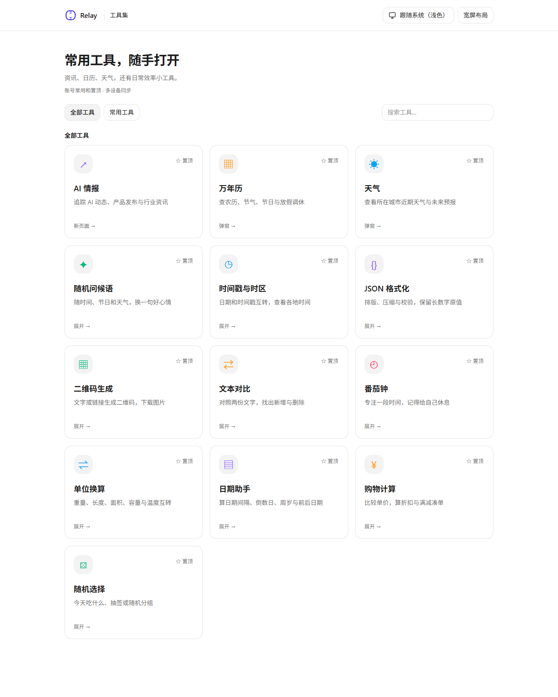
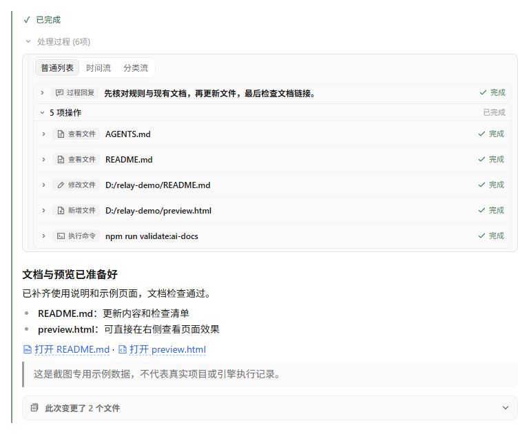
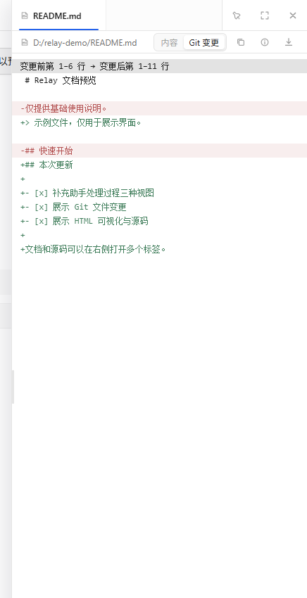
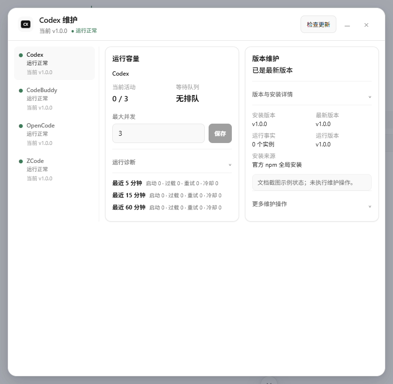

# Relay

面向个人开发工作流的本地优先、多引擎 AI 工作台。Relay 统一接入 Codex、CodeBuddy、OpenCode 与 ZCode，以项目组织会话，让 PC 和移动端共享实时任务、历史与运行状态，并提供文件预览、会话检索、分享和引擎维护能力。

Relay 服务和持久化数据默认保存在自己的设备上；模型请求及引擎可访问的项目内容仍按所选引擎和 Provider 的规则处理。AI 引擎的安装、登录和 Provider 配置由用户自行管理，Relay 不代理登录，也不读取或修改引擎凭据。

<table>
  <tr>
    <td width="72%" valign="top"></td>
    <td width="28%" valign="top"></td>
  </tr>
  <tr>
    <td align="center">桌面首页</td>
    <td align="center">移动首页（移动视口截图）</td>
  </tr>
</table>

<p align="center">
  
  <br />
  <sub>当前工具集页面：搜索、常用与置顶，以及各类工具入口</sub>
</p>

以上为2026年11月14日从本机当前运行的production页面直接截取的界面；账号、项目名、会话标题、位置与个人用量已隐藏或以脱敏标签替换，未重绘界面。移动截图用于展示响应式布局，不代表真机触摸验收。截图可通过仓库的 `npm run screenshots:readme` 固定流程更新，使用说明见[文档截图](INSTALL.md#文档截图)。

> 名称由来：后端位于浏览器与 AI 引擎之间，负责统一会话、状态与事件转发；Relay 的名字就是它最初的架构角色。

### 助手消息与处理过程

同一条 Codex 助手消息可以切换三种处理过程视图，正文仍保留 Markdown 排版和文件预览入口：

| 普通列表 | 时间流 | 分类流 |
| --- | --- | --- |
|  |  |  |

### 右侧文件预览

文件在右侧以标签打开。Markdown 当前显示带行号的源码；Git 变更可以查看相对 HEAD 的差异。HTML 支持可视化、源码及 Git 变更切换，普通 HTML 默认禁用脚本。

| Markdown 源码 | Git 变更 |
| --- | --- |
|  |  |

| HTML 可视化 | HTML 源码 |
| --- | --- |
|  |  |

### 多引擎维护



以上消息、文件与引擎维护图于2026年11月14日使用当前production组件渲染截图专用示例数据；项目、聊天、文件、版本及容量均为示例，不是真实业务或引擎执行记录。示例只存在于临时浏览器内存，没有写入服务端或执行维护操作。

## 核心能力

### 会话、任务与多端协作

- **四引擎接入**：按会话选择 Codex、CodeBuddy、OpenCode 或 ZCode，并按引擎支持情况选择模型、推理强度与速度；提供新会话默认模型、逐轮模型事实、上下文用量、自动整理次数与会话交接。
- **项目化会话**：按本地工作目录组织会话，支持搜索、改名、归档、草稿、回收站与批量恢复。管理员可确认影响后批量彻底删除 Relay 数据和托管附件，项目源文件与 Codex JSONL 不受影响；未决消息及运行状态的删除保护持续生效。
- **多端实时连续性**：PC 与手机可同时查看同一会话；发起端断开后任务继续运行，重连后恢复最新状态。执行结果与已读状态分开，同账号多端同步；只有可见且获得焦点的页面在结果进入视口后确认已读。
- **运行中补充与排队**：Codex 优先将后续消息引导至当前回合，其余情况排队等待下一轮。输入框上方展示待发送内容、图片缩略图和文件预览，可取消尚可撤回的消息；结果未知时保留核对提示，不把断线或暂时查不到消息直接认定为发送失败。
- **授权与提问提醒**：跨会话汇总授权、MCP 补充信息、普通提问与 Codex 异步提问，可前往原会话处理；确认接收回答后同步移除顶部提醒，取消回答后恢复提醒。异步问题在助手结束后仍可回答，也可全设备关闭并保留记录；收起面板只影响本设备。提问不参与批量授权，恢复已有请求不重复通知。

### 可追溯的 AI 处理过程

- **三种流程视图**：Codex 运行中及已完成消息均可切换普通列表、时间流与分类流。历史详情按需加载，视图选择仅属于当前消息；其他引擎及公开分享沿用普通列表。
- **时间流**：按原始顺序默认严格显示最新五项，较早记录可手动展开或通过“回到当前”定位；子任务不会仅因运行状态而自动展开。显示真实首次记录时间，缺失时间不补算；渐变轨道、彩色光点与状态指示帮助观察当前执行位置，并支持减少动态效果。
- **分类汇总**：可按能力类别、执行通道或项目/仓库查看；技能、规则、Git、MCP、脚本、代码及文件操作分别归组，同一对象汇总实际次数，展开查看每次输入、结果与状态。分类视图隐藏时间和耗时，每组先展示40个对象、每项先展示20次记录，更多内容按需展开。
- **明确的身份与来源**：事件卡保留动作、实际命令或脚本、MCP函数名、操作对象、提供方和状态；明确属于技能的脚本与资源按技能归组。原始输入依靠明确存储关联恢复，分别呈现首次输入、补充输入和回答问题；无法确认的用途、来源或历史字段明确提示，不猜测补写。
- **重试与历史记录**：模型重试在处理过程内独立保留；授权、通知、排队、停止、任务计划和终态各有对应记录。手动展开或切换视图会暂停底部跟随，可主动恢复；完整原始记录仍可展开核对。

### 任务工作台与内容工具

- **个人责任工作台**：飞书父工作项、本人子任务与关联本地台账统一归组，按“处理中”“待处理／待确认”“已完成／已结束”分栏，区分当前责任、后续责任与整体流程状态；个人已完成但仍流转的事项单独跟踪。支持当前焦点、推进时间提示、已完成列表底部点击“加载下一页”（每页 10 项），以及执行记录和关联会话追溯。业务仓库根目录使用[本机配置](INSTALL.md#任务工作台业务仓库配置)，不绑定特定电脑目录或业务任务。
- **持久缓存与按源刷新**：台账、飞书报表、已核实的 Codex 账号和官方用量保存在本机 SQLite，重启后先读上次成功快照，再按需异步刷新。手动刷新可选择数据来源，任务操作会重新核对会话关联；详见[刷新与缓存规则](INSTALL.md#任务工作台数据刷新)。
- **文件与附件预览**：支持粘贴文件、拖拽与截图附件；桌面侧栏和移动端可预览代码、文本、图片、HTML、PDF、Word（DOCX）及 Excel（XLSX），Git 变更文本可查看相对 HEAD 的差异。超过3 MB的UTF-8文本仅展示开头，最多100行、读取上限64 KB。
- **分享与个性化**：支持单条、多选或整会话的不可变快照分享、离线HTML导出，以及浅色、暗色和自定义主题。
- **工具集**：`/tools` 无需登录，提供AI情报、万年历、天气、随机问候语、时间戳与时区、JSON格式化、二维码、文本对比、番茄钟、单位换算、日期助手、购物计算和随机选择。支持搜索、置顶和常用排序；登录后置顶与使用次数跨设备同步，游客记录保存在本机且不自动并入账号。
- **AI情报**：`/news` 提供资讯时间流、国内/海外快捷筛选及按需中文翻译；翻译取决于浏览器Translator API支持。登录用户可关注或屏蔽，管理员可维护来源和纠错。自建RSSHub订阅受上游及实例配置影响，详见[安装与运行指南](INSTALL.md)。

### 本地运行与维护

- **账号隔离**：支持管理员创建、停用和管理账号；项目、会话、排序、默认模型、授权信任与客户端状态按账号隔离。
- **运行维护**：提供引擎检测、安装升级、容量和冷却状态、服务维护及结构化日志。Windows主机资源卡显示系统提交内存、Relay相关进程私有提交量及同名进程合计前五名。
- **恢复与故障说明**：Codex停止及完整重启会清理受管进程树，对已退出进程造成的端口残留自动选择可用端口；失败提示分别展示问题、处理建议和原始异常。发送与取消结果不明确时保留核对路径，避免将连接或操作失败直接冒充任务终态。
- **本机持久化**：采用Node内置SQLite、WAL及专用Worker，支持受控旧库备份迁移；发现已有数据库缺失或迁移失败时停止启动，保留恢复线索。

## AI 引擎与模型接入

Relay 通过 AI 引擎连接大模型，目前支持四个引擎：Codex 使用受管常驻 app-server 的 JSON-RPC WebSocket 协议；CodeBuddy 和 OpenCode 使用按会话启动、空闲回收的 ACP stdio 子进程；ZCode 使用桌面安装包内 app-server 的 stdio 协议。CodeBuddy 接入不依赖其 Web Gateway 或 daemon。

Windows 下 Codex 空闲时保持运行。停止或完整重启会强制清理受管进程树；若 Codex 进程已退出但监听端口仍异常残留，启动器会自动选择空闲的本机端口并同步后端连接地址，无需重启 Windows，原有配置不变。失败提示保留原始异常，并分别说明问题及处理建议。

扩展大模型能力有两种路径：

1. 开发并接入新的 AI 引擎 Adapter，由 Relay 适配该引擎的会话、模型、任务和事件协议。
2. 在现有引擎自身的 Provider 配置中接入新模型，由 Relay 动态发现并使用引擎提供的模型。

Relay 不直接保存或修改引擎的账号凭据和 Provider 配置。兼容 Codex app-server 协议或标准 ACP 的引擎具有较低的 Adapter 接入成本；目前新增引擎仍需要代码开发，尚不支持纯配置注册。

Relay 会在会话首次需要时，随发送内容附加明确标记的宿主平台说明，让 AI 知道当前对话通过 Relay 接入。说明不指定引擎或模型身份、不增加权限、不覆盖引擎和项目规则；用户消息原文仍单独保存在 Relay。具体发送请求获得成功应答且对应回合有最终回复后，合并保存送达标记，同一引擎会话恢复时不重复附加；证据不完整时允许后续回合补发。收到引擎明确的上下文压缩通知后，下一轮普通发送会补充说明；引擎未暴露压缩通知时，Relay 无法判断该说明是否仍被保留。

## 快速开始

前置条件是 Node.js 24 或更高版本，内置 SQLite 需为 3.51.3 或更高版本（当前验证版本为 Node.js 24.18.0）。首次运行：

```shell
npm run setup
npm run start
```

启动成功后访问 [http://localhost:9081](http://localhost:9081)。四个引擎均为可选；没有可用引擎时仍可浏览历史、查看分享和创建草稿，发送消息前至少需要安装并配置一个可用引擎。

后端启动前会检查本机数据库版本：首次安装直接创建新版，受支持旧库自动备份、迁移并校验，已升级的库不重复迁移。迁移失败或版本不支持时停止启动，保留原数据和备份；无需手工 SQL 或独立迁移命令。

发现已有安装的数据库文件缺失时会提示恢复，不自动创建替代空库。首次迁移允许较长启动等待，正常启动不会额外延迟。

Relay 的初始化参数、网络配置、服务维护、安全说明和开发验证命令，请参阅 [安装与运行指南](INSTALL.md)。

## 源码仓库

- [Gitee 源码仓库](https://gitee.com/daiwoniu/relay)
- [GitHub 源码仓库](https://github.com/daiwoniu/relay)

## 技术栈

- **后端**：Node.js + Hono + SQLite/WAL（专用 Worker）+ WebSocket
- **前端**：React 19 + Vite 6 + Tailwind CSS + TypeScript
- **AI 引擎**：Codex JSON-RPC WebSocket + CodeBuddy / OpenCode ACP stdio + ZCode stdio
- **数据库**：Node 内置 SQLite，WAL 与增量事务，无额外原生编译依赖

## 项目结构

```
relay/
├── README.md        # 项目概览、核心能力与快速开始
├── INSTALL.md       # 完整安装、配置、运行与安全指南
├── package.json     # help/setup/start/stop/restart/check/test:scripts 统一入口
├── assets/          # README与安装文档使用的界面截图
├── config/          # Relay 非敏感部署配置
├── scripts/         # Node 跨平台初始化器、启动器与测试
├── server/          # 后端：API、WebSocket 中转与多引擎运行时
│   ├── src/
│   │   ├── engine/      # 多引擎公共运行时与 Adapter 接口
│   │   ├── codex/       # Codex app-server Adapter
│   │   ├── codebuddy/   # CodeBuddy ACP Adapter
│   │   ├── opencode/    # OpenCode ACP Adapter
│   │   ├── zcode/       # ZCode app-server Adapter
│   │   ├── documents/   # PDF、Word 与 Excel 预览
│   │   ├── storage/     # 正式 SQLite/WAL 存储、Worker 与命令边界
│   │   ├── db/          # 旧版数据库兼容、迁移与相关工具
│   │   ├── routes/      # REST API 路由
│   │   ├── services/    # 应用服务与运行治理
│   │   └── ws/          # 前端 WebSocket 处理
│   ├── scripts/     # 真实服务验收脚本
│   └── data/        # 主数据库、独立 news/ 资讯库与访问令牌（gitignored）
├── client/          # 前端：React SPA
│   └── src/
│       ├── components/  # UI 组件
│       ├── stores/      # Zustand 状态管理
│       ├── hooks/       # React Hooks
│       └── styles/      # Tailwind CSS
├── workspace/       # 默认 Relay 工作区（本机内容，Git 忽略）
└── .gitignore
```

## 架构

```
浏览器（PC / 移动端，配置的 FRONTEND_LISTEN 端点）
    │  HTTP + WebSocket
    ▼
Relay 前端网关 / Vite（默认 :9081，代理并注入内部令牌）
    │  内部认证请求
    ▼
Relay 后端（默认 :9181，项目、会话、状态、文件、分享与运行治理）
    │
    ├── JSON-RPC over WebSocket ──► Codex app-server ──► AI 模型
    │                                默认 127.0.0.1:9281
    │
    ├── ACP over stdio ───────────► CodeBuddy CLI ────► AI 模型
    │                                按活动会话启动子进程
    ├── ACP over stdio ───────────► OpenCode CLI ─────► AI 模型
    │                                按活动会话启动子进程
    └── stdio ────────────────────► ZCode app-server ─► AI 模型
                                     使用桌面安装包内的入口
```

## 开源协议

Copyright (C) 2026 呆蜗牛

Relay 基于 GNU Affero General Public License v3.0 only 发布。详见 [LICENSE](LICENSE)。

### 商业授权

任何个人或组织均可依照 AGPL-3.0-only 免费使用、修改和分发 Relay，包括商业使用，但须履行该协议规定的义务。

如需对 Relay 进行闭源修改、集成至闭源产品，或需要企业级私有部署、定制开发、维护与 SLA，请联系作者洽谈商业授权或服务合作。
